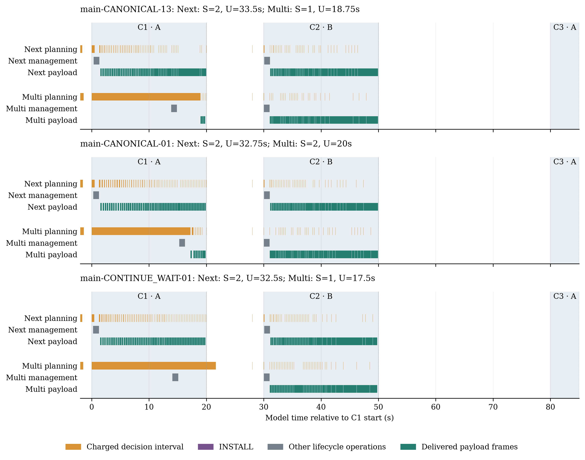

# X01 с начислением времени принятия решений

В завершённых основных парах выигрыш Multi по числу обслуженных контактов не наблюдался после начисления измеренного времени выбора действия.

Основная серия: 80/80 FINISHED; статусы: `{'FINISHED': 80}`. Контроли и пилоты считаются отдельно. Это результат для X01 и измеренного настольного компьютера, а не универсальное отрицание пользы горизонта.

## Постановка и контроль

Сохранены два горизонта H1/H2, оба правила разрешения равенства, пять приоритетов, алгоритм, порядок обхода, seed и retention. X01 содержит A[0,20], B[30,50], A[80,85]с. Начало t=-2 перенесено из успешных архивных полных запусков; t=0 в инструкции относится к диагностическому корню. Запасной пары, атак и отказов нет. PREPARE/INSTALL/ключи/SA исполняются общим исполнителем.

Одинаковые лимиты:150000 узлов на поиск,30 с поиска,32 с выбора,180 с контроллера,210 с watchdog; Java21.0.10, heap1024MiB, свежая JVM без специального прогрева. Ryzen7 5800HS,8 ядер/16 потоков, RAM16541487104 байта, Windows11 build26200. Все попытки последовательны; в нечётной паре первым идёт Next, в чётной Multi. Фоновая активность ОС не отключалась и причинно не атрибутировалась.

Перед регистрацией исправлена совместимость measured-контроллера: существующая проверка доказанного остатка теперь включена в измеряемый цикл. Коммит `b2d04b8`;13 целевых тестов пройдены. Новый JAR сохраняет 6703 прочих записей исходного JAR побайтно, включая solver/portfolio/offline-контроллер. Это отдельная версия, не оптимизация поиска.

| Контроль | Статус | S | U,с | CPU,с | Management,B | Ключи |
|---|---|---:|---:|---:|---:|---:|
|CONTINUE_WAIT / H1|FINISHED|2|38|0.12|160|0|
|CONTINUE_WAIT / H2|FINISHED|3|37|0.83|1240|2|
|CANONICAL / H1|FINISHED|2|38|0.12|160|0|
|CANONICAL / H2|CONTROLLER_TIME_LIMIT|—|—|—|—|—|

Offline-различие CW 2 против 3 и все пять координат воспроизведены. Незавершённый контроль CAN не получает финального нуля. Четыре пилота проверили цикл начисления/повторной проверки; их результаты не входят в 80 основных попыток.

## Основные результаты

| Правило | Полные пары /20 | Победы / равенства / проигрыши Multi по S | Незавершённые | ΔU,с: медиана [min;max] |
|---|---:|---|---:|---|
|CONTINUE_WAIT|20/20|0 / 0 / 20|0|-15 [-15.75; -13]|
|CANONICAL|20/20|0 / 5 / 15|0|-14.25 [-15.5; -11]|

Победы/равенства/проигрыши классифицированы по S только среди полных пар. ΔU и проценты рассчитаны по каждой полной паре отдельно; при нулевом Next процент отсутствует. Полный лексикографический исход также сохранён в `tables/pairs.csv`.
По полному порядку пяти критериев Multi проиграл в 40/40 полных пар; равенство по S само по себе не является равенством результата.

| Правило / политика | FINISHED /20 | S: частоты | U,с | Host контроллер,с | Выбор,мс |
|---|---:|---|---|---|---|
|CONTINUE_WAIT / Next|20/20|{2: 20}|32.75 [32; 33.5]|6.857 [6.036; 9.706]|28.779 [1.083; 728.28]|
|CONTINUE_WAIT / Multi|20/20|{1: 20}|17.75 [17.5; 19.5]|22.86 [21.065; 29.619]|14.182 [1.541; 15035.71]|
|CANONICAL / Next|20/20|{2: 20}|32.75 [27.75; 33.5]|6.905 [6.064; 13.286]|28.461 [1.151; 779.657]|
|CANONICAL / Multi|20/20|{1: 15, 2: 5}|18.125 [16.75; 20]|21.598 [20.164; 25.184]|15.18 [1.269; 18540.615]|

В трёх последних столбцах указаны медиана[min;max]; длительности выбора агрегированы по отдельным решениям, а не средним по запускам. Полные UL/DL, расходы операций, служебные байты, созданные ключи, узлы и причины остановки доступны для каждой попытки в `tables/runs.csv`, для каждого контакта — в `tables/contacts.csv`.

| Правило / политика | CPU операций,с | Служебные байты | Новые направленные ключи |
|---|---|---|---|
|CONTINUE_WAIT / Next|0.12 [0.12; 0.12]|160 [160; 160]|0 [0; 0]|
|CONTINUE_WAIT / Multi|0.12 [0.12; 0.12]|160 [160; 160]|0 [0; 0]|
|CANONICAL / Next|0.12 [0.12; 0.12]|160 [160; 160]|0 [0; 0]|
|CANONICAL / Multi|0.12 [0.12; 0.12]|160 [160; 160]|0 [0; 0]|

Здесь также медиана[min;max]. В этих основных попытках расходы операций совпали; различие результатов определяется обслуживанием и полезным временем. Новых направленных ключей фактически не создано.

## Механизм и границы измерения

В представительной паре `main-CONTINUE_WAIT-01` (LOSS по S) решение Multi №1 началось в t=0 и стало доступно в t=14.086; измерено 14.086 с, намерение OPEN, исход `REVALIDATED_FIRST_ACTION`. В наблюдении нет нового материала и выполняемой подготовки/установки ключей: даже при свободных ресурсах PREPARE 2 с+INSTALL 4 с уже не помещается до t=20. Это необходимая временная граница, не дополнительный поиск контрфактического оптимума.
Первые циклы выбора внутри C1: t=0→14.086, OPEN, REVALIDATED_FIRST_ACTION; t=14.086→21.636, WAIT, WAIT_EVENT_REACHED_REPLAN.

В представительной паре `main-CANONICAL-01` (TIE по S) решение Multi №1 началось в t=0 и стало доступно в t=15.274; измерено 15.274 с, намерение OPEN, исход `REVALIDATED_FIRST_ACTION`. В наблюдении нет нового материала и выполняемой подготовки/установки ключей: даже при свободных ресурсах PREPARE 2 с+INSTALL 4 с уже не помещается до t=20. Это необходимая временная граница, не дополнительный поиск контрфактического оптимума.
Первые циклы выбора внутри C1: t=0→15.274, OPEN, REVALIDATED_FIRST_ACTION; t=15.274→16.541, WAIT, WAIT_EVENT_REACHED_REPLAN.

В представительной паре `main-CANONICAL-13` (LOSS по S) решение Multi №2 началось в t=13.871 и стало доступно в t=18.946; измерено 5.075 с, намерение WAIT, исход `WAIT_EVENT_REACHED_REPLAN`. В наблюдении нет нового материала и выполняемой подготовки/установки ключей: даже при свободных ресурсах PREPARE 2 с+INSTALL 4 с уже не помещается до t=20. Это необходимая временная граница, не дополнительный поиск контрфактического оптимума.
Первые циклы выбора внутри C1: t=0→13.871, OPEN, REVALIDATED_FIRST_ACTION; t=13.871→18.946, WAIT, WAIT_EVENT_REACHED_REPLAN.

Начисляется каждый полный цикл выбора: observation/candidates, проверка/подготовка доказанного остатка, seed, проверка допустимого продолжения, DFS и сравнение. Во время него общая шкала продвигает уже начатую работу и события. Затем выполняется новая проверка действия. Сохранённый доказанный план не становится сертификатом для сдвинутого кадра; это проверено тестами и отражено в guard-журнале.

Запись checkpoint, свежая проверка допуска, фактическое исполнение, старт JVM и финальный экспорт не начисляются как время выбора. Эти расходы входят в соответствующие host/process измерения. Поэтому эксперимент не моделирует полностью все вычислительные накладные расходы бортовой системы. Модельная CPU-стоимость GS+SC не является host CPU/time поиска. В показателях задержки нет ретроспективного вычитания суммарного времени из контактов.

Рисунок выбран воспроизводимо: для каждого правила и наблюдаемого S-исхода берётся полная пара с ΔU, ближайшим к медиане группы; равенство разрешается по ID. Пилоты не участвуют. Непрерывность готовности не выводится из одной активации; обслуживание подтверждено доставленными кадрами по 400 байт в обоих направлениях.

## Вывод и материалы

В завершённых основных парах выигрыш Multi по числу обслуженных контактов не наблюдался после начисления измеренного времени выбора действия. Offline-допустимость полезного плана и возможность вычислить/исполнить его вовремя — разные утверждения. Границы относятся к одному сценарию, двум правилам и данному режиму настольной JVM. Они не доказывают отсутствие пользы Multi при иных алгоритмах/бюджетах/оборудовании и не дают оценки вероятности компрометации. Новых оптимизаций или искусственно подобранных задержек в этой серии нет.

Все исходные попытки, включая лимиты, сохранены; итоговые S/U незавершённых запусков пусты, префиксы помечены отдельно. Команды, manifest и исходники находятся в README и пакете воспроизведения. После обсуждения результатов пользователь одобрил обновление статьи: постановка, результаты, обсуждение, заключение и затем аннотация обновлены с сохранением исходного оформления. Проверки и отдельная версия материалов описаны в [заметке об обновлении статьи](../article-x01-update/README.md). Опубликованный ранее архив сохранён без изменений.
